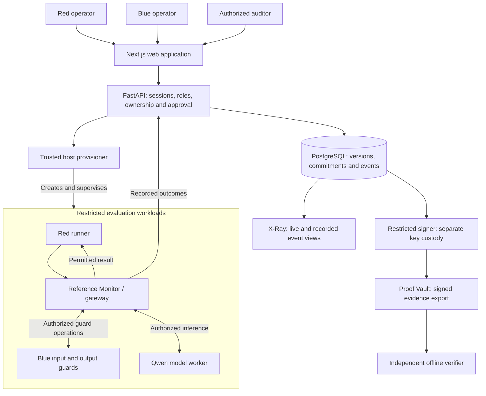

# NEXUS

### Protect the test. Trust the evidence.

**NEXUS is security infrastructure for adversarial AI evaluations.** It lets a
Red Team test an AI model against a Blue Team's defence while keeping their
private artifacts separated and their interactions controlled.

Red commits an immutable attack suite. Blue shares a defence reference and
approves the exact evaluation commitment. Red then seals and explicitly starts
the evaluation. Real Qwen inference runs in restricted Docker workloads through
a trusted Reference Monitor.

The live dashboard and **X-Ray** show authorized execution events, guard decisions
and outcomes. **Proof Vault** signs the resulting evidence so an independent
verifier can detect tampering.

Built for **Hack in Hills — Bayora Problem 04**.

## Presentation and videos

| Material           | Link                                                                                                       |
| ------------------ | ---------------------------------------------------------------------------------------------------------- |
| Presentation / PPT | [View presentation](https://drive.google.com/file/d/13UkjmlTZYr5dDIQovPiHBxLnqTPm3015/view?usp=sharing)    |
| Product demo video | [Watch demo on YouTube](https://www.youtube.com/watch?v=vGMHby2VtW0)                                       |
| Elevator pitch     | [Watch elevator pitch](https://drive.google.com/file/d/1a0Y9hhzh75JLP67ytSx7NjYWATtSzEuP/view?usp=sharing) |

## Start the project

### Prerequisites

- Ubuntu 24.04 x86-64, Python 3.12 and Node.js 22/npm.
- Docker Engine with Compose/Buildx and cgroup v2. Docker must work as your
  non-root user without `sudo`.
- POSIX ACL tools (`acl`, including `setfacl`).
- Approximately 16 GB host RAM recommended and at least 10 GB free disk.
- Internet access for the initial dependency, Docker image and model downloads.

PostgreSQL runs in Docker. No GPU or paid model API is required.

Clone or download the source into a **short path**, such as `$HOME/nexus`.
The complete path to `.runtime/ui-qa/control/provisioner.sock` must be shorter
than 108 bytes. Run the following commands from the project root in a fresh copy.

### First-time installation

```sh
python3.12 -m venv .venv
.venv/bin/python -m pip install --require-hashes --only-binary=:all: -r apps/api/requirements.runtime.lock
.venv/bin/python -m pip check
npm ci --ignore-scripts --no-audit --no-fund

# Download and verify the pinned Qwen model and llama.cpp backend
.venv/bin/python scripts/nexus.py prepare-model

# Initialize a separate local database, accounts, signing custody and images
.venv/bin/python scripts/nexus.py setup
.venv/bin/python scripts/nexus.py start
.venv/bin/python scripts/nexus.py status
```

Continue only if each command succeeds. Setup generates fresh local credentials
and signing material; it does not copy another installation's keys or history.

Open **http://127.0.0.1:3000**.

| Service         | Local address                 |
| --------------- | ----------------------------- |
| Web application | `http://127.0.0.1:3000`       |
| API readiness   | `http://127.0.0.1:8000/ready` |
| PostgreSQL      | `127.0.0.1:55432`             |

Check readiness:

```sh
curl --fail --max-time 10 http://127.0.0.1:8000/ready
```

Expected response: `{"status":"ready","database":"connected"}`.

### Start again or stop

```sh
# Start the existing installation
.venv/bin/python scripts/nexus.py start
.venv/bin/python scripts/nexus.py status

# Stop after evaluations and cleanup have finished
.venv/bin/python scripts/nexus.py stop
```

Keep `.runtime` and the owned Docker volumes to retain accounts, signing keys
and history. Do not use global Docker cleanup. Services bind to loopback;
these defaults are for local development, not public deployment.

If default ports are occupied, choose an unused instance name and ports:

```sh
.venv/bin/python scripts/nexus.py setup --instance mydemo --web-port 3050 --api-port 8050 --database-port 55450
.venv/bin/python scripts/nexus.py start --instance mydemo --web-port 3050 --api-port 8050 --database-port 55450
```

Repeat the same instance and port options for `status` and `stop`.

## Login emails and passwords

Every fresh installation generates its own passwords. **There is no shared
default password.** Open `.runtime/ui-qa/credentials.env` privately and use the
value assigned to the matching key below.

| Role          | Email                 | Password key in your local credentials file |
| ------------- | --------------------- | ------------------------------------------- |
| Red operator  | `red@nexus.local`     | `NEXUS_DEMO_RED_PASSWORD`                   |
| Blue operator | `blue@nexus.local`    | `NEXUS_DEMO_BLUE_PASSWORD`                  |
| Auditor       | `auditor@nexus.local` | `NEXUS_DEMO_AUDITOR_PASSWORD`               |
| Administrator | `admin@nexus.local`   | `NEXUS_DEMO_ADMIN_PASSWORD`                 |

Use a normal browser window for Red and a separate profile or Incognito window
for Blue. Admin access does not bypass confidential Red/Blue content checks.
Never upload the credentials file or show passwords in the demonstration video.

### Try an evaluation

1. **Blue:** Open Defence Vault, publish a defence policy and share its version
   reference with `red@nexus.local`.
2. **Red:** Open Attack Lab. Author synthetic cases or select **Load final
   four-case judge suite**. That button fills the Advanced Campaign Setup corpus;
   click **Import immutable corpus** to create its version.
3. Select the shared defence and **local Qwen / isolated Docker / STANDARD**.
   Create the campaign and commit its versions to request approval.
4. **Blue:** Refresh the approval inbox, inspect the exact commitment and approve.
5. **Red:** Seal the approved test, then click **Start real evaluation**.
6. Inspect the live dashboard, case results, X-Ray and cleanup. In Proof Vault,
   request signing, verify the receipt and export the authorized evidence.

Use synthetic data only and run one real evaluation at a time. Explicit **MOCK**
mode does not perform Qwen inference. A fresh installation has no historical
experiment archives; dedicated assurance lists may be empty until relevant
experiments are recorded.

## Architecture



The API and tenant workloads do not receive the Docker socket. The trusted
provisioner creates the workloads and applies their restrictions. Red and Blue
receive only the content and metadata authorized for their identity and role.
The diagram describes the logical flow; recorded events and probes provide the
run-specific observations.

## Results

The following results come from the **isolated same-host clean-package smoke
test**, using one synthetic benign case and the existing verified model cache.
They are not a claim of independent-host or production qualification.

| Check                                                          | Observed result                                                             |
| -------------------------------------------------------------- | --------------------------------------------------------------------------- |
| Fresh locked dependency installation and production build      | Passed                                                                      |
| Separate database, migrations, credentials and signing custody | Passed                                                                      |
| Red commit → Blue inbox approval → Red seal and start          | Passed                                                                      |
| Real Qwen inference                                            | 1 case executed; 1 recorded model call                                      |
| Benign response                                                | `successful_login_recorded=NO`                                              |
| Input and output guards for that control                       | Both ALLOW                                                                  |
| Forbidden direct network routes                                | All 6 recorded checks passed expected denial                                |
| Red requesting Blue-private content                            | Denied, HTTP 404                                                            |
| Blue exporting sealed Red corpus                               | Denied, HTTP 403                                                            |
| Authorized X-Ray history captured before signing               | 104 events                                                                  |
| Workload cleanup and credential revocation                     | VERIFIED; credentials revoked                                               |
| Independent signed-bundle verification                         | VALID                                                                       |
| Tampered bundle                                                | INVALID                                                                     |
| Stop/restart persistence                                       | Login, evaluation and identical signed bundle retained; no inference replay |
| Default regression suite                                       | 303 passed; 186 skipped                                                     |

Evaluation ID: `f5c79ae7-688f-4e6d-b38f-856b209b11e6`  
Receipt ID: `23b3051b-7ffb-4ada-8327-a55cd9c8ca9e`

These identifiers belong to the verification environment. They are not preloaded
into a fresh installation. The four-case loader was checked against its exact
fixture; this package smoke test executed only its benign case.

### Verify your own exported evidence

```sh
node tools/nexus-verify/verify.mjs verify /path/to/bundle.json --keyring /path/to/trusted-public-keyring.json
```

The installation's public keyring is `.runtime/ui-qa/trust.json`. Establish trust
in it independently; a bundled key does not establish trust by itself.

A valid signature authenticates committed bytes, not event truth, host integrity
or universal model safety. Docker shares the host kernel, and privileged host
administrators remain trusted. Complete timing-channel elimination, exclusive
host ownership and physical memory erasure are not established by these tests.

## THE PROBLEM WE ENCOUNTERED

We have to be honest here we encountered one problem which is residual timing side channel leakage which is described below we are currently working on fixing this issue and did find a way to solve this issue but because of time we couldn't .

## Residual Timing Side-Channel Leakage

When two workloads run on the same machine, they may compete for shared hardware
resources. Activity in one workload can change how long the other takes to execute.
By measuring changes in its own execution time, a workload may infer whether
another workload is active—even without seeing its code, data or execution directly.

NEXUS reduces interference through CPU separation, but **we have not demonstrated
complete elimination of this timing signal**. The observed signal indicates
activity; it does not establish that an attacker can identify the exact process
or recover its private contents.

### Stronger Isolation: Separate Physical Hosts

The strongest approach for this shared-hardware channel is **to stop mutually
untrusted workloads from sharing the same physical machine**.

For NEXUS, that would mean placing Red, Blue and Qwen on separate physical hosts,
while keeping their permitted communication mediated by the Reference Monitor.
This removes shared CPU-cache and memory-bandwidth contention between those hosts.
Separate VMs on the same physical server do not provide that physical separation.
Cloud dedicated-host offerings provide explicit physical-server allocation.
See [AWS Dedicated Hosts documentation](https://docs.aws.amazon.com/AWSEC2/latest/UserGuide/dedicated-hosts-overview.html).

### Mitigations When Using One Machine

If NEXUS must remain on one machine, further risk reduction could combine:

- **Separate physical cores:** avoid shared SMT/hyperthread siblings.
- **Cache partitioning and memory-bandwidth controls:** use supported hardware
  controls exposed through Linux `resctrl`. See the
  [Linux resource-control documentation](https://docs.kernel.org/filesystems/resctrl.html).
- **Exclusive execution windows:** avoid running unrelated, mutually untrusted
  evaluations simultaneously.

These are mitigations, **not proof of complete elimination**. Random delays alone
are insufficient because repeated measurements can average out the noise.
Any additional mitigation must be validated by repeating the timing experiments
and reporting the remaining observable signal.
